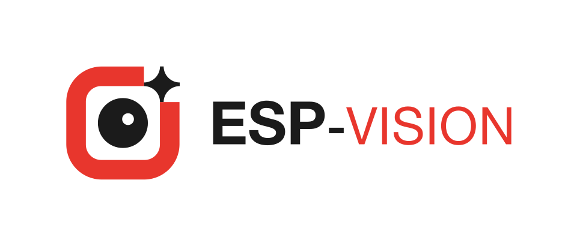

<p align="center">
  <picture>
    <source media="(prefers-color-scheme: dark)" srcset="docs/_static/ESP-VISION_logo_dark.svg">
    <source media="(prefers-color-scheme: light)" srcset="docs/_static/ESP-VISION_logo.svg">
    
  </picture>
</p>

# ESP-VISION

[](https://www.npmjs.com/package/@esp-vision/device-core) [](host/device-core/LICENSE)

**Low-Code Edge AI & Computer Vision Framework for Espressif SoCs**

[English](README.md) | [简体中文](README_ZH.md)

## Overview

ESP-VISION is a Low-Code Edge AI & Computer Vision Framework for Espressif SoCs. It deeply integrates essential capabilities including camera capture, image processing, video encoding and decoding, network transmission, model deployment, and AI inference, while providing unified and standardized Python APIs that enable developers to rapidly build edge applications combining visual capture, intelligent recognition, display, and media streaming.

- Unified and standardized Python APIs for camera capture, image input, display, video encoding, preview, and streaming across supported chips and boards, enabling low-code application development.
- Image processing capabilities covering drawing, filtering, color tracking, feature detection, QR codes, barcodes, and AprilTags.
- ESP-DL-powered AI inference for object detection, pose estimation, and image classification, with a streamlined path for deploying models to edge devices.
- Efficient C/C++ foundation components work closely with on-chip multimedia peripherals and hardware acceleration modules to deliver high-performance, real-time application execution.
- Development through a VSCode-based host tool or [Web IDE](https://ide.vision.espressif.com/), with firmware builds managed through `idf.py`.

**Document Center**:

- [中文](https://docs.espressif.com/projects/esp-vision/zh_CN/latest/)
- [English](https://docs.espressif.com/projects/esp-vision/en/latest/)

## EV-MUX: Host Communication

EV-MUX v4 provides IDEs, host tools and independent Agent adapters with discovery, control, framed Python interaction and JPEG preview. Board-enabled `usj`, `usb`, `uart` and `tcp` links share one owner session, which owns both user/debug streams.

The [Communication System and EV-MUX chapter](docs/en/communication/index.rst) is the detailed reference for [console/log architecture](docs/en/communication/architecture.rst), [interfaces and board configuration](docs/en/communication/interfaces.rst), [ownership and recovery](docs/en/communication/sessions.rst), [wire protocol](docs/en/communication/wire-protocol.rst), files, preview, Wi-Fi provisioning and acceptance.

v4 still uses `EVMUX/1` framing. Hosts must implement explicit acquisition and keepalive; `route.bind`/`route.auto` are unsupported. Runtime `capabilities` determines available interfaces. TCP has no authentication or encryption in this implementation.

## Architecture

<picture>
  <source media="(prefers-color-scheme: dark)" srcset="docs/_static/esp-vision-architecture.svg">
  <source media="(prefers-color-scheme: light)" srcset="docs/_static/esp-vision-architecture-light.svg">
  
</picture>

IDE, Agent, CLI and custom tools share Device Core; EV-MUX connects that host SDK to device firmware. See [Solution architecture and licensing](https://docs.espressif.com/projects/esp-vision/en/latest/esp32p4/architecture/index.html) for the role of each layer.

The [license inventory](docs/en/license/index.rst) records upstream components and adaptations, including the MIT-licensed MicroPython execution and thread overlays used for EV-MUX session isolation.

## Quickstart

Prerequisites: ESP-IDF v5.5.6 for ESP32-P4/S3, or release/v6.1 for ESP32-S31 with the export script sourced (`idf.py` on `PATH`), and a [supported board](https://docs.espressif.com/projects/esp-vision/en/latest/esp32p4/target-support/index.html).

```bash
git clone --recursive https://github.com/espressif/esp-vision.git esp-vision
cd esp-vision
idf.py --board ESP32_P4X_EYE -p /dev/ttyACM0 build flash monitor
```

- `--board ESP32_P4X_EYE`: Selects the board configuration; replace `ESP32_P4X_EYE` with another supported board when required.
- `-p /dev/ttyACM0`: Selects the device port; replace `/dev/ttyACM0` with the port reported by the development host.
- `build`: Configures the project and compiles the firmware.
- `flash`: Writes the generated firmware image to the connected device.
- `monitor`: Opens the serial console after flashing; press `Ctrl-]` to exit.

> Note: When building on Windows, install [Visual Studio Build Tools](https://visualstudio.microsoft.com/visual-cpp-build-tools/) so the build can create MicroPython's host-side `mpy-cross.exe`. In the Visual Studio Build Tools installer, select the "Desktop development with C++" workload and make sure the "MSVC v143 - VS 2022 C++ x64/x86 build tools" component is selected.

## ESP-IDF Compatibility

CI builds and published firmware use the following board/IDF combinations:

| Boards | ESP-IDF dependency | CI image |
| --- | --- | --- |
| ESP32-P4 and ESP32-S3 boards (including `TEMPLATE`) | **v5.5.6** | `espressif/idf:v5.5.6` |
| ESP32-S31 boards (`ESP32_S31_CHATBOT`, `ESP32_S31_KORVO`, `ESP32_S31_MOSAICO`) | **release/v6.1** | `espressif/idf:release-v6.1` |

Use the matching ESP-IDF checkout and source its `export.sh` before invoking `idf.py`. v5.5.6 is pinned to a patch release; `release/v6.1` follows the maintained 6.1 branch required by S31. Other ESP-IDF versions, including newer patches, release/v6.0 and master, are outside this CI qualification matrix. ESP-IDF or managed-component API changes can cause configuration/build failures, change runtime behavior or alter the Python APIs exposed by MicroPython. Such builds may need source, overlay or dependency adjustments and require their own hardware verification.

With the current overlay, v5.5.6 provides SSL/TLS, `cryptolib`, WebSocket, WebREPL, socket events and, where the chip supports them, `machine.I2S`, PCNT and I2C target mode. These optional features remain disabled on the 6.1 build; inspect the actual firmware before relying on them.

## Demos

|||
| --- | --- |
| Hand Detect | Cat Detect |
|  |  |
| AprilTag | Canny |
|  |  |
| Color Detect | QR Code |
|  |  |
|||

## Resources

- [Device Core SDK and API reference](https://docs.espressif.com/projects/esp-vision/en/latest/esp32p4/device-core/index.html)

- [Supported Chips and Boards](https://docs.espressif.com/projects/esp-vision/en/latest/esp32p4/target-support/index.html)
- [Web IDE](https://ide.vision.espressif.com/)
- [Examples](example/)
- [Customize firmware features](https://docs.espressif.com/projects/esp-vision/en/latest/esp32p4/how-to/customize-firmware.html)
- [Solution architecture and licensing](https://docs.espressif.com/projects/esp-vision/en/latest/esp32p4/architecture/index.html)
