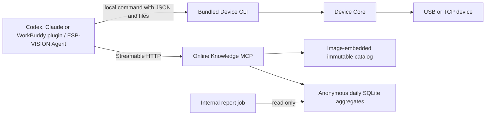
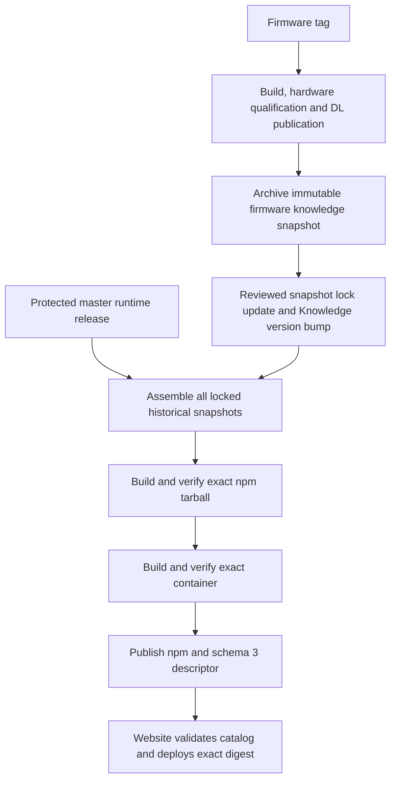

# MCP ownership, release and acceptance

## Runtime architecture



The Agent owns its AI loop. Device CLI exposes capabilities through versioned JSON results, NDJSON events and binary output files using public Device Core APIs. The plugin uses one capability-oriented Skill and its own fixed CLI path. Each command releases its device session; batch operations reuse one connection and stop at the first failure. Knowledge MCP receives knowledge requests only; device source, photos, credentials and local execution state are not forwarded to it.

Statistics count completed tool handlers by UTC day, tool, selected trusted firmware version (`catalog` for `server_info`) and success/error outcome, with elapsed-time sum and maximum. Health probes, MCP initialization, resources and SDK-rejected arguments do not count; `server_info` calls do count. There are no user, IP, client, session or request identifiers, raw arguments, query strings, tool results or exception messages in the database. These are best-effort operational aggregates, not an audit log or unique-user count: unavailable/locked writes may be skipped to keep knowledge queries responsive. Default retention is 90 days. Read-only table/JSON reporting is available through `dist/stats-cli.js`, not a public HTTP endpoint.

## Artifact production and deployment



The main repository owns server source, knowledge generation, tests, Dockerfile, image and release descriptor. The website repository owns deployment configuration, preflight, rollback and internal reporting. It never rebuilds the Knowledge MCP service. Firmware continues through its existing qualification and DL publication pipeline; Knowledge MCP artifacts use GitLab package/container registries.

The `esp-vision-mcp-knowledge` Generic Package version is the Knowledge npm version, independent of firmware tags. It contains `knowledge-mcp.tgz`, `mcp-catalog.json`, `mcp-catalog.sha256`, `mcp-release.json` and `mcp-release.sha256`. Descriptor schema 3 binds npm name/version/byte count/SHA-256, runtime source commit, catalog hash and byte count, the complete snapshot identity inventory (including active flags), `latestFirmwareVersion`, and the immutable image digest. Its `version` equals `npm.version`. Catalog schema 1 contains `activeSnapshots` (firmware → revision) and `snapshots`; each snapshot carries `firmwareVersion`, `snapshotVersion`, `firmwareSourceCommit`, `contentSourceCommit`, `packSha256` and the exact original JSON in `packJson`. The catalog retains every revision and designates one active revision per firmware; the required `latestFirmwareVersion` explicitly identifies the latest official firmware among active mappings, independently of TAG spelling. It is used only for an explicitly approved client-side fallback, never as a server query default. Website must support schema 3 before this producer is merged. Legacy schema 1/2 packages remain available for explicitly selected rollbacks, not as defaults for new publication.

Npm provenance schema 2 binds `packageName`, `packageVersion`, runtime `sourceCommit` and `catalogSha256`. HTTP health and `server_info` return those runtime identity fields, `npmArtifactSha256` and the descriptor's snapshot inventory. Firmware/content commits belong to each snapshot and need not equal the runtime commit. Website validates all identities and catalog entries before deployment, then checks health and representative exact-version queries. Identical publication retries may complete partial uploads; conflicting existing bytes abort before writes. The descriptor checksum is uploaded last. Retain Generic Packages and referenced image digests, and configure registry duplicate protection; CI artifact expiration is not historical retention.

The bridge passes `ESP_VISION_MCP_PACKAGE_VERSION`, `ESP_VISION_MCP_PROJECT_ID` and `RELEASE_EXPECTED_SOURCE_COMMIT`. Configure protected `MCP_ALLOWED_IMAGE_REPOSITORY` in website with the main repository's full Knowledge image repository, such as `gitlab.espressif.cn:5050/ae_group/esp-vision/knowledge-mcp`. Website checks this setting in its prepare stage and validates descriptors against this independently configured allowlist, both checksums and exact version/source identity. It ignores legacy bridge image hints: a registry variable that expands incorrectly in a trigger job cannot choose a deployment repository. The bridge forwards the explicit `KNOWLEDGE_MCP_VERSION` configured in the Knowledge rules; package preparation verifies it equals `host/knowledge-mcp/package.json`. Update both rule values when bumping this npm version. No firmware tag or runtime dotenv substitution selects the deployment version. Manual redeployment selects an existing package version and exact image; it does not rebuild or select a mutable image tag.

Before production enablement, allow the website project's job token to read the main project's Generic Packages and container repository, and verify that the upstream trigger user can start website pipelines. Keep the package and image registries private. Website reporting is a default-branch-only manual job, serialized with production deployment; reports are internal artifacts. Website operational details live in that repository's deployment documentation.

## npm delivery

Four public packages have independent versions: `@esp-vision/device-core` is the SDK; `@esp-vision/device-cli` is the device command toolkit; `@esp-vision/knowledge-mcp` provides the same knowledge service over stdio or HTTP with a complete snapshot; `@esp-vision/plugin` bundles the CLI, official Knowledge HTTP configuration and a capability Skill. The plugin's knowledge endpoint is `https://mcp.vision.espressif.com/mcp`.

Users install a published plugin version with `npx -y @esp-vision/plugin install codex` or `npx -y @esp-vision/plugin install claude`. The installer stores its runtime in a persistent versioned data directory and uses native client commands. The bundled CLI is invoked from that installed path, independent of a global CLI or the npx cache. See [plugin installation](../host/esp-vision-plugin/README.md) and [standalone CLI](../host/device-cli/README.md).

Core 0.5.0 moves the command into the CLI package. Existing Core 0.4.x installations retain their old command until explicitly upgraded or removed. To replace a global Core 0.4.x command, remove its global package and install the standalone CLI. SDK dependencies in applications use Core directly. Consumers declare a minor-locked Core range such as `~0.5.0`; the lockfile records the resolved patch and integrity. MR integration substitutes a recorded Core tarball only in temporary installation metadata. Tracked manifests and npm archives contain registry versions. Publication checks that the pinned Core integrity already exists in npm.

Core and CLI publish automatically from protected default-branch push pipelines when their declared npm version is not yet in the registry. Existing versions are skipped; increment the corresponding version before releasing changes. CLI release builds install the published Core from the registry lock and record its actual bundled patch; the Core publication job is a required prerequisite for CLI packaging, including CLI-only changes (an already published Core version is checked and skipped). For a coordinated release, commit the next Core version in the CLI lock without inventing its future registry URL or integrity; MR checks qualify the source tarball, and protected master resolves the actual npm archive after Core publication. A changed bundled Core requires a new CLI npm version. MR and feature-branch pipelines run checks without publishing.

Plugin and Knowledge npm packages publish independently from protected default-branch push pipelines when release metadata changes. Firmware-tag pipelines cannot publish npm. Plugin retains its minor-locked Core/CLI ranges and exact resolved versions; Knowledge has no Core/CLI dependency or release pin. When versions change together, Core publishes before the CLI release build, CLI publishes before Plugin release packaging, and Plugin copies and verifies that published CLI archive. The actual dependency order is Core → CLI → Plugin. If Knowledge releases in the same pipeline, Plugin publication also waits for the website bridge to finish successfully. Every actual Plugin publication probes its configured online Knowledge endpoint for the required health, version inventory and exact-query contract before contacting npm for publication; dry runs use a local server and never require production to have the candidate deployed. Do not change a consumer to an unpublished dependency without the corresponding upstream release or ordering gate. Existing Plugin/Knowledge versions must match the checked artifact integrity; changed bytes require a new version.

## Coordinated package versions

The firmware 2026.11.14 release uses the following independently versioned host packages. Core, CLI and Plugin are already published; Knowledge 0.3.0 is the subsequent snapshot-import release. Verify the registry version, archive integrity and exact bundled dependencies at each release gate; a source manifest alone does not establish publication.

| Package | Version | Exact bundled dependency | Publication gate |
| --- | --- | --- | --- |
| Device Core | 0.8.1 | None | Protected master, SDK release checks |
| Device CLI | 0.2.1 | Core 0.8.1 | Published Core archive and resolved lock, checked CLI tarball |
| Plugin | 0.2.0 | CLI 0.2.1 / Core 0.8.1 | Published CLI archive, successful concurrent Knowledge deployment and live endpoint contract |
| Knowledge MCP | 0.3.0 | No Core/CLI pin | Checked catalog/npm/container, descriptor publication and website deployment |

Core 0.8.1, CLI 0.2.1, Plugin 0.2.0 and the preceding Knowledge MCP 0.2.0 completed npm publication independently of the firmware tag. Knowledge 0.3.0 imports its qualified 2026.11.14 snapshot without rebuilding or republishing Plugin 0.2.0. For subsequent coordinated releases, install the website consumer contract before publishing a new Knowledge descriptor and publish Core and CLI before Plugin. Verify the final dependency pins, versioned Knowledge instructions and live API contract before Plugin publication. Once an npm version exists, changed bytes require a new version, including a dependency-only rebuild.

Knowledge 0.3.0 retains firmware 2026.10.21, 2026.10.23 and 2026.11.06 and adds 2026.11.14, with `latestFirmwareVersion=2026.11.14`. Its new snapshot is pinned to the immutable archive produced after tag qualification and DL publication, with firmware/content commit `d4ec1543f6c498daac40cf77cc4f0b053241940e` and pack SHA-256 `c3c2933cd28bf6e1a4a70cf80822ca6884642695b98844090cbe7ae18c5cf1de`. Newly supported firmware is a minor-version addition; the reviewed import and Knowledge deployment remain separate from firmware publication. Do not add a guessed future archive URL/hash or advance the latest pointer before the snapshot exists.

## Firmware and Knowledge release procedure

1. Merge firmware changes and maintained bilingual documentation with a root `[Unreleased]` changelog entry. Prepare the firmware tag and release notes independently of npm versions. Run the final firmware/build/target acceptance matrix through CI.
2. Push the protected firmware tag. The existing firmware qualification and DL upload gates must pass before `publish_firmware_knowledge_snapshot` archives `snapshot.json` and `snapshot.sha256` under `esp-vision-knowledge-snapshot/<firmware-version>/`. The envelope binds exact generated pack bytes and the tag commit. Conflicting bytes cannot replace an existing snapshot. A snapshot upload failure can be retried without repeating npm publication.
3. To expose that firmware online, add the archived snapshot URL, SHA-512 integrity and five identity fields to `host/knowledge-mcp/snapshots.json`; keep all existing entries and firmware mappings, and set `latestFirmwareVersion` to the intended latest official firmware without rewriting its TAG. Review the source artifact against the firmware tag, not against runtime master. Knowledge availability is a separate release milestone; until it is deployed the Plugin reports the missing version and offers an official update; only an explicit decline permits the documented alternate snapshot selection.
4. Bump the Knowledge npm version and release type, update `KNOWLEDGE_MCP_VERSION` in both CI rules and review the catalog diff. Build, schema-check all historical snapshots, exercise HTTP/stdio and verify the container. The publish gate compares the previous stable npm catalog and forbids removing or changing retained revisions. A new revision may change the active mapping only within its own firmware version.
5. Protected master publishes the checked npm bytes, then the schema 3 Generic Package and bridge request. Website deploys the verified digest. Preserve the previous deployment identity for explicit rollback. No firmware reflash or new firmware tag is needed for a runtime-only release.

The initial catalog bootstraps firmware 2026.10.21, 2026.10.23 and 2026.11.06 from original npm 0.1.0, 0.1.1 and 0.1.2 archives. Their exact integrity, pack hash and commits are checked in `snapshots.json`. There is no claim that unarchived older firmware is supported; such a request fails closed.

By default, all four npm packages use the same strict version policy, including before 1.0: `patch` is exclusively for backward-compatible bug fixes; `minor` is the only release type that may add backward-compatible functionality; and only `major` may introduce a breaking API, behavior, CLI, protocol or configuration change. Patch and major releases must not add unrelated new features. Starting at `0.5.1`, the next releases are `0.5.2`, `0.6.0` or `1.0.0` respectively. Set `espVisionReleaseType` to `patch`, `minor` or `major` when bumping each package. Publication compares the requested version with the highest stable version already in npm, rejects skipped or incorrect steps, and resets lower components on minor/major bumps. A release must document the changes and pass compatibility tests; classification and behavioral compatibility also require review because version arithmetic cannot establish them. The firmware tag does not replace these package versions.

Knowledge 0.2.0 is an explicit pre-1.0 migration exception: required firmware selectors and the new response/resource/health contracts are breaking changes from 0.1.x, released with `espVisionReleaseType: minor` while the service remains below 1.0. Update website and Plugin consumers before deployment. This exception does not relax version classification for Core, CLI or Plugin.

The plugin includes the official ESP-VISION logo. Native Codex and Claude installs are registered through their client CLIs. `npx -y @esp-vision/plugin install workbuddy` prepares a versioned local Skill ZIP, the official Knowledge MCP JSON and an import guide. The installer reports `manual-install-required`; the user must import the Skill and activate the Knowledge connector through WorkBuddy’s documented UI. The installer does not edit WorkBuddy settings or verify app activation. Preserve unrelated MCP servers when adding the official endpoint. The local Skill format has no documented icon field, so bundling the logo does not imply a WorkBuddy card icon. See the [plugin installation guide](../host/esp-vision-plugin/README.md).

## Runtime contracts

Use `esp-vision-device --help --json` to discover commands and limits. Python source, local files and device files share the SDK execution semantics; omitting an execution or file-read timeout omits the aggregate deadline, while protocol/setup steps remain bounded. Explicit deadlines and signals cancel host waits. Cancellation or disconnect does not establish that the program stopped or that a side effect was rolled back; inspect state before retrying an uncertain operation. Starting a device file and exiting acknowledges startup and releases ownership; it creates no daemon or resumable job. `watch` holds ownership for its explicit duration. Another client must release its session before the CLI acquires it.

Knowledge service factory imports do not load a pack, create a statistics database or listen on a port. The npm stdio entry defaults to its packaged catalog and ignores statistics settings; protocol output uses stdout and diagnostics stderr. HTTP retains the official tools and anonymous aggregate reporting. All content tools require an exact `firmwareVersion`, with optional `snapshotVersion`; missing and unavailable versions never select latest implicitly. The Plugin offers an official firmware update first. Only after the user explicitly declines does its helper select the explicit `latestFirmwareVersion` from `list_firmware_versions`, pin the active `snapshotVersion` and disclose potential device incompatibility. Silence, update failure or catalog failure does not authorize fallback; device changes, reconnection and flashing reset the choice. Successful content results return `{snapshot,result}` with visible provenance and `_meta.knowledgeSnapshot` for programmatic callers. Module resources include `/firmware/{firmwareVersion}/` in their URI. The public factory, KnowledgeCatalog and Pack loaders are available from `@esp-vision/knowledge-mcp/service`.

## Reproducible validation

For a host-only CI run of this release path, set `ESP_VISION_DEVICE_CORE_ONLY=1` and `ESP_VISION_BUILD_KNOWLEDGE=1` on the feature branch. This runs Knowledge packaging/image/container validation without compiling or flashing firmware and does not enable npm publication. Firmware tags still select their full qualification and snapshot-archive path.

Set `ESP_VISION_WEBSITE_CHECKOUT` to the absolute path of the website checkout to validate. Select Node 24, then run the following from the main checkout. Both paths must remain under the project directory; output contains logs and the machine-readable result list.

```sh
python3 tools/ci/mcp/acceptance.py \
  --website "$ESP_VISION_WEBSITE_CHECKOUT" \
  --output "$PWD/.cache/mcp-acceptance" \
  --install
```

Add `--port /dev/ttyACM0 --python /absolute/path/to/python3` for optional P4 target checks. Add `--native-codex /absolute/path/to/codex --native-claude /absolute/path/to/claude` for isolated first/repeat installation, upgrade and failure/retry acceptance. Since Plugin 0.1.0 is the first public release, upgrade checks default to an explicitly synthetic 0.0.0 fixture; this fixture is never published. On later releases, optionally pass `--previous-plugin-tarball /absolute/path/to/previous-public-plugin.tgz` to validate the actual prior public package. Native isolation requires Linux and Bubblewrap and preserves real client settings. Target checks require a dedicated ESP32_P4X_EYE, may interrupt its existing application, and retain live LCD/camera JPEGs alongside structured results.

This checks the actual Core, CLI, Knowledge and plugin archives; packed Knowledge stdio/HTTP calls and anonymous statistics; plugin installation logic and archive extraction; canonical Core regression tests; producer publication faults, website types/Wi-Fi/firmware/release/deployment tests, and the exact Knowledge npm bytes with the actual producer bridge variables against the website consumer. It does not deploy services or publish npm packages. The container CI gate separately starts a uniquely named disposable container and volume, exercises a real MCP call and CLI report, recreates the container and verifies retained counts. The production lock and service names are never used by that gate.

Merge website consumer support first, then main producer/bridge support. Deploy the first new descriptor only after package/container access and the real container gate pass. Preserve the prior image digest and stats volume for rollback.
