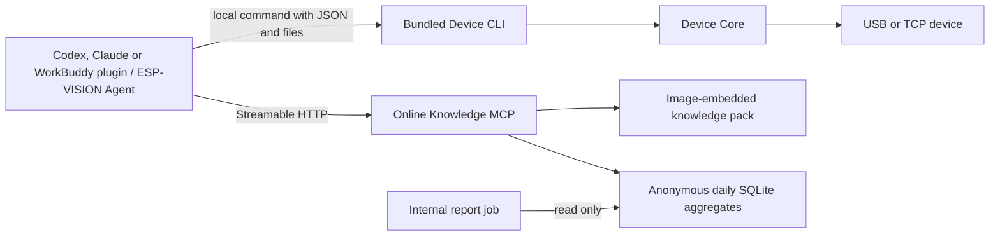
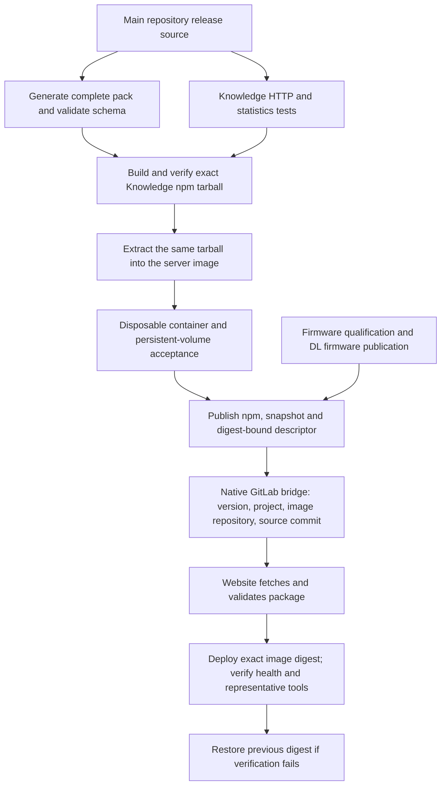

# MCP ownership, release and acceptance

## Runtime architecture



The Agent owns its AI loop. Device CLI exposes capabilities through versioned JSON results, NDJSON events and binary output files using public Device Core APIs. The plugin uses one capability-oriented Skill and its own fixed CLI path. Each command releases its device session; batch operations reuse one connection and stop at the first failure. Knowledge MCP receives knowledge requests only; device source, photos, credentials and local execution state are not forwarded to it.

Statistics count completed tool handlers by UTC day, tool, trusted pack version and success/error outcome, with elapsed-time sum and maximum. Health probes, MCP initialization, resources and SDK-rejected arguments do not count; `server_info` calls do count. There are no user, IP, client, session or request identifiers, raw arguments, query strings, tool results or exception messages in the database. These are best-effort operational aggregates, not an audit log or unique-user count: unavailable/locked writes may be skipped to keep knowledge queries responsive. Default retention is 90 days. Read-only table/JSON reporting is available through `dist/stats-cli.js`, not a public HTTP endpoint.

## Artifact production and deployment



The main repository owns server source, knowledge generation, tests, Dockerfile, image and release descriptor. The website repository owns deployment configuration, preflight, rollback and internal reporting. It never rebuilds the Knowledge MCP service. Firmware continues through its existing qualification and DL publication pipeline; Knowledge MCP artifacts use GitLab package/container registries.

The `esp-vision-mcp-knowledge` Generic Package version contains `knowledge-mcp.tgz`, `mcp-pack.json`, `mcp-pack.sha256`, `mcp-release.json` and `mcp-release.sha256`. Schema 2 binds the npm name/version/byte count/SHA-256, its embedded snapshot and provenance, source commit and exact image digest. Website verifies this identity before deployment and against HTTP health afterwards. Schema 1 is accepted only for an explicitly selected manual legacy rollback. The descriptor binds exact pack bytes, version, source commit and immutable `repository@sha256:digest`. Identical publication retries may complete a partial upload; conflicting existing bytes abort before writes. The descriptor checksum is uploaded last. The publication job is serialized; do not enable alternative writers that bypass its identity checks. Configure registry duplicate protection and retain the referenced container digests to preserve old-release redeployment.

The bridge passes `ESP_VISION_MCP_PACKAGE_VERSION`, `ESP_VISION_MCP_PROJECT_ID`, `ESP_VISION_MCP_IMAGE_REPOSITORY` and `RELEASE_EXPECTED_SOURCE_COMMIT`. The consumer validates both checksums, exact version/source identity and the permitted registry repository. A runtime-generated dotenv value is not required by the native bridge. Manual redeployment selects an existing package version and exact image; it does not rebuild or select a mutable image tag.

Before production enablement, allow the website project's job token to read the main project's Generic Packages and container repository, and verify that the upstream trigger user can start website pipelines. Keep the package and image registries private. Website reporting is a default-branch-only manual job, serialized with production deployment; reports are internal artifacts. Website operational details live in that repository's deployment documentation.

## npm delivery

Four public packages have independent versions: `@esp-vision/device-core` is the SDK; `@esp-vision/device-cli` is the device command toolkit; `@esp-vision/knowledge-mcp` provides the same knowledge service over stdio or HTTP with a complete snapshot; `@esp-vision/plugin` bundles the CLI, official Knowledge HTTP configuration and a capability Skill. The plugin's knowledge endpoint is `https://mcp.vision.espressif.com/mcp`.

Users install a published plugin version with `npx -y @esp-vision/plugin install codex` or `npx -y @esp-vision/plugin install claude`. The installer stores its runtime in a persistent versioned data directory and uses native client commands. The bundled CLI is invoked from that installed path, independent of a global CLI or the npx cache. See [plugin installation](../host/esp-vision-plugin/README.md) and [standalone CLI](../host/device-cli/README.md).

Core 0.5.0 moves the command into the CLI package. Existing Core 0.4.x installations retain their old command until explicitly upgraded or removed. To replace a global Core 0.4.x command, remove its global package and install the standalone CLI. SDK dependencies in applications use Core directly. Consumers pin the exact Core version; MR integration substitutes a recorded Core tarball only in temporary installation metadata. Tracked manifests and npm archives contain registry versions. Publication checks that the pinned Core integrity already exists in npm.

Core, CLI and plugin publication use protected default-branch pushes and the protected npm credential. Knowledge npm publication uses a protected firmware release tag after package checks, container verification and firmware qualification: its embedded version/source identity changes per release, so each changed snapshot needs a new declared npm package version. CI builds the snapshot and tarball once; npm publication and the image consume those exact bytes. Existing npm versions must have identical integrity; changed content requires a version bump. Website performs deployment and rollback using the verified image digest.

The plugin includes the official ESP-VISION logo. Native Codex and Claude installs are registered through their client CLIs. `npx -y @esp-vision/plugin install workbuddy` prepares a versioned local Skill ZIP, the official Knowledge MCP JSON and an import guide. The installer reports `manual-install-required`; the user must import the Skill and activate the Knowledge connector through WorkBuddy’s documented UI. The installer does not edit WorkBuddy settings or verify app activation. Preserve unrelated MCP servers when adding the official endpoint. The local Skill format has no documented icon field, so bundling the logo does not imply a WorkBuddy card icon. See the [plugin installation guide](../host/esp-vision-plugin/README.md).

## Runtime contracts

Use `esp-vision-device --help --json` to discover commands and limits. Python source, local files and device files share the SDK execution semantics; omitting an execution or file-read timeout omits the aggregate deadline, while protocol/setup steps remain bounded. Explicit deadlines and signals cancel host waits. Cancellation or disconnect does not establish that the program stopped or that a side effect was rolled back; inspect state before retrying an uncertain operation. Starting a device file and exiting acknowledges startup and releases ownership; it creates no daemon or resumable job. `watch` holds ownership for its explicit duration. Another client must release its session before the CLI acquires it.

Knowledge service factory imports do not load a pack, create a statistics database or listen on a port. The npm stdio entry defaults to its packaged snapshot and ignores statistics settings; protocol output uses stdout and diagnostics stderr. HTTP retains the official tools and anonymous aggregate reporting. The public factory and Pack loader are available from `@esp-vision/knowledge-mcp/service`.

## Reproducible validation

Set `ESP_VISION_WEBSITE_CHECKOUT` to the absolute path of the website checkout to validate. Select Node 24, then run the following from the main checkout. Both paths must remain under the project directory; output contains logs and the machine-readable result list.

```sh
python3 tools/ci/mcp/acceptance.py \
  --website "$ESP_VISION_WEBSITE_CHECKOUT" \
  --output "$PWD/.cache/mcp-acceptance" \
  --install
```

Add `--port /dev/ttyACM0 --python /absolute/path/to/python3` for optional P4 target checks. Add `--native-codex /absolute/path/to/codex --native-claude /absolute/path/to/claude` for isolated first/repeat installation, upgrade and failure/retry acceptance. Since Plugin 0.1.0 is the first public release, upgrade checks default to an explicitly synthetic 0.0.0 fixture; this fixture is never published. On later releases, optionally pass `--previous-plugin-tarball /absolute/path/to/previous-public-plugin.tgz` to validate the actual prior public package. Native isolation requires Linux and Bubblewrap and preserves real client settings. Target checks require a dedicated ESP32_P4X_EYE, may interrupt its existing application, and retain live LCD/camera JPEGs alongside structured results.

This checks the actual Core, CLI, Knowledge and plugin archives; packed Knowledge stdio/HTTP calls and anonymous statistics; plugin installation logic and archive extraction; canonical Core regression tests; producer publication faults, website types/Wi-Fi/firmware/release/deployment tests, and the exact Knowledge npm bytes with the actual producer bridge variables against the website consumer. It does not deploy services or publish npm packages. The container CI gate separately starts a uniquely named disposable container and volume, exercises a real MCP call and CLI report, recreates the container and verifies retained counts. The production lock and service names are never used by that gate.

Merge website consumer support first, then main producer/bridge support. Deploy the first new descriptor only after package/container access and the real container gate pass. Preserve the prior image digest and stats volume for rollback.
