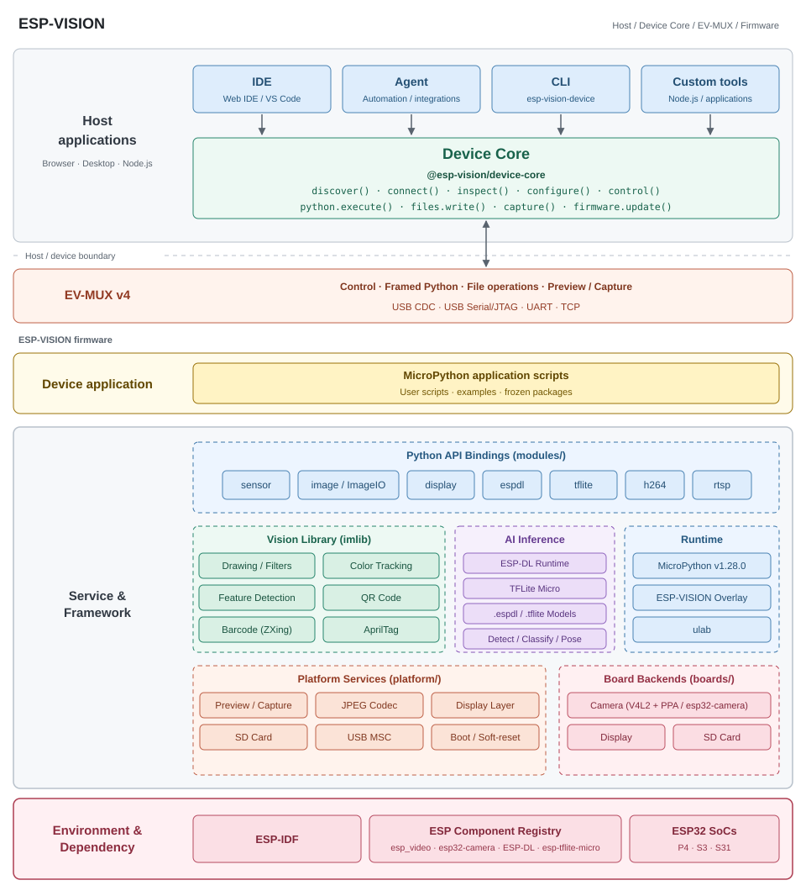

Device Core npm 包对接
======================

:link_to_translation:`en:[English]`

完整的 SDK 介绍与 API 索引见 :doc:`device-core/index <index>`，应用 API 参数、返回值和事件见 :doc:`device-core/api <api>`，所有高级导出见 :doc:`device-core/advanced <advanced>`。本页保留可直接运行的接入示例。

本页面向把设备接入 IDE、Agent、CLI 或自定义主机应用 的主机开发者。``@esp-vision/device-core`` 是无 UI 的共享通信包；主机只提供物理字节连接，不需要复制参考 Python 客户端或实现第二套协议。完整帧格式见 :doc:`communication/wire-protocol <../communication/wire-protocol>`，物理接口见 :doc:`communication/interfaces <../communication/interfaces>`。

源码、版本与安装
----------------

Device Core 源码在 ESP-VISION 固件仓库的 ``host/device-core/`` 维护。``host/`` 表示运行在主机的代码，不是固件模块；IDE 与 Agent 是 npm 包的消费者，Agent 的 MCP、模型提供方和插件仍在独立项目维护。协议变更应在同一个 MR 对齐固件、Core、文档与测试。

包使用独立版本，不与固件版本或 IDE 版本绑定。本页示例面向 ``@esp-vision/device-core@0.1.1``，只支持 EV-MUX v4；v3 返回 ``VERSION_MISMATCH``，应用应提示更新固件。确认公开 npm registry 已发布该版本后再安装；后续版本仍以实际发布结果为准，dry run 或创建 MR 不等于发布。

.. code-block:: console

   npm view @esp-vision/device-core@0.1.1 version dist.integrity
   npm install --save-exact @esp-vision/device-core@0.1.1

Node 主机基线是 Node.js 22。浏览器需要打包器或 import map 解析包名，以及 Web Serial 或二进制 WebSocket 桥。包不附带串口驱动、网络桥、模型、IDE UI 或 Agent 运行时；Node mDNS 发现使用可选 peer ``multicast-dns``。发布前可安装本地 ``npm pack`` 产物验证，正式消费者应固定 npm 版本并更新 lockfile。

应用、Core 与传输的职责
-----------------------

   IDE / Agent / CLI / 自定义工具 → Device Core → EV-MUX → 固件

本图与项目 README、系统架构章节复用同一 SVG。主机应用负责设备选择及界面/流程策略，Device Core 负责共享 API、协议和会话状态，EV-MUX 定义与固件的运行时通信；字节适配器提供串口/socket I/O，不维护另一套协议栈。图中代表性 API 不替代完整参考；发现与 ROM 烧写各有独立生命周期，ROM loader 不通过 EV-MUX 写镜像。

每个设备连接创建一个 ``createDevice({ transport })`` 对象；根入口只导出这个工厂函数。Core 负责解析、关联请求、会话、保活、REPL 协调和操作生命周期。应用负责设备选择、展示与业务策略；传输适配器负责打开连接及可靠收发原始字节，不获取 EV-MUX 所有权、不重编码协议。

传输契约只有两个必需方法：``writeBytes(Uint8Array): Promise`` 在全部字节被宿主连接接受后完成，失败时 reject；``subscribe({ data, error, close })`` 转发原始字节、错误与断线，且必须同步返回取消订阅函数。可选 ``connect({ signal })`` / ``disconnect()`` 打开、关闭物理连接。Core 先订阅再连接、握手；已打开的连接可以省略 ``connect``。短写或 WOULD_BLOCK 不能当成完整发送，旧连接退订后不能继续输入数据。

独立 Node TCP 示例
------------------

将以下内容存为 ``core-tcp.mjs``，在安装包的项目运行 ``node core-tcp.mjs <device-ip>``。设备需已联网并支持 v4，TCP 默认端口为 3232。该示例使用命令行指定的设备地址，发现流程见后文。

.. code-block:: javascript

   import net from 'node:net'
   import { once } from 'node:events'
   import { createDevice } from '@esp-vision/device-core'

   const host = process.argv[2]
   if (!host) throw new Error('Usage: node core-tcp.mjs <device-ip>')
   const socket = new net.Socket()
   const transport = {
     subscribe({ data, error, close }) {
       socket.on('data', data)
       socket.on('error', error)
       socket.on('close', close)
       return () => {
         socket.off('data', data)
         socket.off('error', error)
         socket.off('close', close)
       }
     },
     async connect({ signal }) {
       socket.connect({ host, port: 3232 })
       await once(socket, 'connect', { signal })
     },
     writeBytes(bytes) {
       return new Promise((resolve, reject) => {
         socket.write(bytes, error => error ? reject(error) : resolve())
       })
     },
     async disconnect() { socket.destroy() },
   }
   const device = createDevice({ transport })
   const unsubscribe = device.on('python.output', text => process.stdout.write(text))
   try {
     await device.connect({ role: 'tcp' })
     console.log(await device.inspect({ fields: ['identity', 'capabilities'] }))
     console.log(await device.python.execute({ source: 'print(1 + 2)', completion: 'wait' }))
   } finally {
     try { await device.disconnect() }
     finally { unsubscribe() }
   }

``connect()`` 协商会话并探测 REPL，可能中断原有 Python 程序；它不是无副作用的在线探测。``inspect()`` 默认查询身份、能力和运行状态，也可以通过 ``fields`` 明确查询 ``network`` / ``storage``。``disconnect()`` 负责释放会话、终止待处理操作、退订并调用传输关闭方法；即使连接失败，也应在 ``finally`` 清理。

浏览器 Web Serial 示例
----------------------

从用户点击事件调用 ``connectSerial()``；``requestPort`` 需要安全上下文及用户选择。以下示例将 USB CDC 作为 ``role: 'usb'``，USJ 对应 ``'usj'``。先释放 reader/writer 锁，再关闭串口。

.. code-block:: javascript

   import { createDevice } from '@esp-vision/device-core'

   async function connectSerial() {
     const port = await navigator.serial.requestPort()
     await port.open({ baudRate: 115200 })
     const reader = port.readable.getReader()
     const writer = port.writable.getWriter()
     let listeners = null
     let reading = null
     const transport = {
       subscribe(next) {
         listeners = next
         reading = (async () => {
           try {
             for (;;) {
               const { value, done } = await reader.read()
               if (done) break
               listeners?.data(value)
             }
             listeners?.close()
           } catch (error) { listeners?.error(error) }
           finally { reader.releaseLock() }
         })()
         return () => { listeners = null }
       },
       writeBytes: bytes => writer.write(bytes),
       async disconnect() {
         await reader.cancel().catch(() => {})
         await reading
         writer.releaseLock()
         await port.close()
       },
     }
     const device = createDevice({ transport })
     const unsubscribe = device.on('python.output', text => console.log(text))
     try {
       await device.connect({ role: 'usb' })
       await device.python.execute({ source: 'print(123)', completion: 'wait' })
     } finally {
       try { await device.disconnect() }
       finally { unsubscribe() }
     }
   }

浏览器网络模式通过二进制 WebSocket 桥接，仍使用相同的 transport 契约与 ``role: 'tcp'``。适配器须检查 WebSocket OPEN、限制 ``bufferedAmount`` 并在断线时报告失败；调用 ``send`` 不能证明设备已收到数据。UI 应订阅 ``state`` 并处理意外断线，桥接细节见 :doc:`communication/host-integration <../communication/host-integration>`。

文件与交互式 Python
-------------------

以下操作假设 ``device`` 已连接，输出通过 ``device.on('python.output', handler)`` 接收。上传与执行分别进行，没有隐式上传后运行选项。

.. code-block:: javascript

   const source = 'print("device-core example")\n'
   await device.files.write({ path: '/core-example.py', data: source })
   const readback = await device.files.read({ path: '/core-example.py', encoding: 'utf-8' })
   if (readback !== source) throw new Error('Readback mismatch')
   const run = await device.python.execute({ path: '/core-example.py', completion: 'start' })
   const result = await run.done
   console.log(result.ok, result.path)
   await device.files.remove({ path: '/core-example.py' })

   await device.python.input('print(123)\r')
   await device.control({ action: 'stop' })

``python.execute`` 的 ``source`` 与 ``path`` 二选一；``completion: 'wait'`` 等待结果，``'start'`` 返回包含 ``done`` Promise 的启动句柄。启动返回或上传成功不能替代执行完成证据。无限运行需 ``control({ action: 'stop' })``，保持接收并等待执行结果；停止 ACK 不能替代资源清理完成。

``files.list/read/write/remove/mkdir`` 是唯一应用文件入口。``files.write`` 接收字符串或 ``Uint8Array``，目前仍使用 ``script.write`` 的 Base64/JSON 分块 RPC；此 API 整理尚未实现高速原始二进制传输。读取和目录操作当前使用 framed REPL。文件系统必须已挂载、允许写入且有临时文件空间。终端输入、自动脚本和文件操作共用一个解释器；Core 对冲突的自动操作返回 ``DEVICE_BUSY``，应用不能同时向自动操作使用的 REPL 注入终端输入。详细边界见 :doc:`communication/python-files <../communication/python-files>`。

Wi-Fi 配置与状态
----------------

.. code-block:: javascript

   await device.configure({ network: {
     credentials: { ssid: '<wifi-ssid>', password: '<wifi-password>' },
     enabled: true,
   }, timeout: 45000 })
   const { network } = await device.inspect({ fields: ['network'] })
   console.log(network.state, network.ipv4)
   await device.configure({ network: { enabled: false } })
   // Clear saved credentials and disable networking:
   // await device.configure({ network: { credentials: null } })

``configure`` 是局部更新：省略字段不变，``credentials: null`` 清除凭据并关闭网络，不能同时指定 ``enabled: true``。提供凭据时必须同时包含 ``ssid`` 与 ``password``，开放网络使用空密码。Core 关联事务并等待结果，不只返回固件 accepted；配置由顺序操作组成而非原子事务。失败时 ``error.completed`` / ``error.pending`` 描述已确认步骤与未完成事务，不自动回滚。``timeout`` 与 ``signal`` 在同一个请求对象中传入。

优先通过 USB 配网，避免网络修改使 TCP 连接断开。配置与诊断不得记录密码；查询不返回已保存密码。配网后先释放 USB，再建立 TCP 会话，不能转移旧 token。

发现与身份核验
--------------

固件通过 ``_esp-vision._tcp.local`` 发布主芯片设备 ID、完整板名、固件版本、规范主机名和协议版本。主机名格式为 ``esp-vision-<full-board-name>-<last-6-mac-hex>-<firmware-version>``，串口、TCP、Python 与发现查询一致。发现不会连接设备或抢占会话；在线不表示空闲。

Node 安装可选 ``multicast-dns`` peer 后使用：

.. code-block:: javascript

   import { createDevice } from '@esp-vision/device-core'
   import { createNodeDiscovery } from '@esp-vision/device-core/discovery/node'
   import { tcpTransport } from '@esp-vision/device-core/node'

   const device = createDevice({ discovery: createNodeDiscovery() })
   const devices = await device.discover({ timeout: 3000 })
   const selected = devices.find(item => item.compatible && item.addresses.length)
   if (!selected) throw new Error('No compatible device found')
   const tcpAdapter = tcpTransport({ host: selected.addresses[0], port: selected.port })
   try {
       await device.connect({ transport: tcpAdapter, role: 'tcp', expectedDevice: selected })
       console.log(await device.inspect({ fields: ['identity'] }))
   } finally { await device.disconnect() }

应用调用 ``device.discover()``。``createNodeDiscovery()`` 和 ``createBridgeDiscovery()`` 返回 provider，契约为 ``list({ timeout, signal })``，不提供 ``discover()``；通过 ``createDevice({ discovery: provider })`` 注入。0.1.1 起，官方 ``tcpTransport({ host, port })`` 和 ``serialTransport({ serial, python })`` 适配器由 ``@esp-vision/device-core/node`` 导出，构造时不打开连接；串口所选解释器需安装 pyserial。见 :doc:`advanced`。

浏览器使用 ``@esp-vision/device-core/discovery`` 中的 ``createBridgeDiscovery('ws://127.0.0.1:8766/device')`` 注入本地桥。浏览器没有原生 DNS-SD 枚举能力。结果包含 ``deviceId``、``hostname``、``board``、``firmwareVersion``、``addresses``、``port``、``compatible``，桥接结果还可能有 ``connectionUrl``。宿主据此构造连接适配器，使用 ``expectedDevice`` 在获取会话前核验 ID 与主机名，防止 DHCP 地址陈旧；这不是认证。VLAN、组播过滤和 AP 隔离可能需要手动地址，过期桥接句柄需要重新发现。

预览、日志与抓帧
----------------

.. code-block:: javascript

   const unsubscribePreview = device.on('preview', image => {
     const url = URL.createObjectURL(new Blob([image.data], { type: image.mimeType }))
     const previous = imageView.src
     imageView.src = url
     if (previous.startsWith('blob:')) URL.revokeObjectURL(previous)
   })
   const unsubscribeLog = device.on('log', text => systemLog.write(text))
   const image = await device.capture({ source: 'camera', format: 'jpeg', timeout: 15000 })
   // image: { data: Uint8Array, mimeType: 'image/jpeg', metadata }
   // Call unsubscribePreview()/unsubscribeLog() and revoke the final URL on UI teardown.

``imageView`` 与 ``systemLog`` 是宿主 UI 对象。``on`` 返回取消订阅函数，图像事件和抓帧结果都包含原始 JPEG 字节，不需要 UI 再解析 EV-MUX。Core 分发前核验会话及 epoch；preview 由设备程序 ``img.flush()`` 触发，拥塞时允许丢帧。摄像头抓帧需要可执行 VM。

``capture({ source: 'screen', format: 'jpeg' })`` 调用专用 ``debug.capture_screen``，返回 LCD 最后提交的 RGB565 帧编码的 JPEG；它在 VM 任务中运行，不调用摄像头或改变屏幕。无 LCD 返回 ``NOT_SUPPORTED``，未初始化/无有效帧返回 ``DISPLAY_NOT_READY``；不会回退到摄像头。旧固件缺少该能力时由 Core 报告不支持。高速原始二进制上传仍未实现。真机测试通过 ``npm run test:hardware`` 的 ``--screen-output`` 显示测试图案并保存抓屏，见 :doc:`communication/validation <../communication/validation>`。

复位、烧写与发布
----------------

.. code-block:: javascript

   await device.control({ action: 'reset', mode: 'soft', timeout: 15000 })
   // await device.control({ action: 'reset', mode: 'hard' })
   // await device.control({ action: 'bootloader' })

软复位由 Core 协调新的 ready epoch 和 REPL 屏障；超时或取消后先检查状态，不自动重放原业务。硬复位和进入下载模式会使原有链路失效，成功应答不等于设备已重新上线。

ROM 烧写仍使用独立子路径 ``@esp-vision/device-core/firmware``；宿主注入 ROM loader、已批准镜像、芯片/分区约束和复位策略。Core 不附带镜像，不在 EV-MUX 上执行 ROM 下载协议。``control({ action: 'bootloader' })`` 只请求进入下载模式，不进行烧写。物理交接见 :doc:`communication/interfaces <../communication/interfaces>`。

包的源码、协议测试与发布流程在 ``host/device-core/`` 同仓维护；IDE、Agent 固定依赖发布到 npm 的版本，不长期复制源码。仅修改 SDK 时运行 JS 测试、schema/package 检查与发布 dry run，不应触发固件编译矩阵。发布与固件版本独立，正式 registry 可用性以发布 job 和 ``npm view`` 为准。协议能力仍需由版本/能力协商与真机测试确认，验收见 :doc:`communication/validation <../communication/validation>`。

应用层固件更新入口
------------------------------------------

应用调用 ``device.firmware.check()`` 自动获取官方发布目录及各版本元数据；``catalog`` 仅用于覆盖为自定义源。通过 ``device.firmware.update({ release, openLoader, ... })`` 安装选定的兼容版本。包内 CLI 已提供 Node ROM 适配器，命令行用户无需配置 loader 脚本；JavaScript 宿主通过 ``openLoader`` 适配其串口/Web Serial 环境。完整目录、取消与复位契约见 :doc:`api`，底层 loader 适配仍可直接使用 FirmwareFlashSession。
